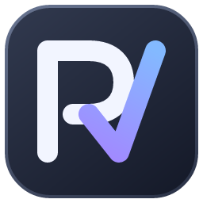

# RynthV



使用 Rust + egui 开发的歌声合成引擎。

## 构建与运行

需要 Rust 1.99.0，版本由 `rust-toolchain.toml` 指定。

### Windows

需要 MSVC、Windows SDK 和支持 DX12 的显卡。

```powershell
cargo run --release
```

### Linux

支持 X11 / Wayland，使用 Vulkan 或 OpenGL。Ubuntu 24.04 构建示例：

```sh
sudo apt install build-essential pkg-config libasound2-dev libwayland-dev libxkbcommon-dev \
  fontconfig fonts-noto-cjk libvulkan1 libegl1 libgl1 xdg-desktop-portal xdg-desktop-portal-gtk
cargo build --release --locked --bins
./target/release/rynthv
```

需要可用的图形驱动、ALSA 音频设备和桌面对应的 XDG 门户后端（KDE 使用 `xdg-desktop-portal-kde`）。

## 声库与配置

首次使用请在设置中选择声库目录和发音词典目录；程序不附带声库、词典或用户模型上下文。

| 声库类型 | Windows | Linux |
| --- | --- | --- |
| 一代声库 | 支持 | 支持 |
| 二代声库 | 需要提供模型上下文 | 需要提供模型上下文 |

配置目录：Windows 为 `%LOCALAPPDATA%/RynthV`，Linux 为 `$XDG_CONFIG_HOME/RynthV`（未设置时为 `$HOME/.config/RynthV`）。模型上下文在 Windows 保存在 `%APPDATA%/RynthV/context.json`，Linux 保存在上述配置目录的 `context.json`。

命令行合成与诊断工具的用法可通过 `cargo run --release --locked --bin rynthv-synth -- --help` 查看。
